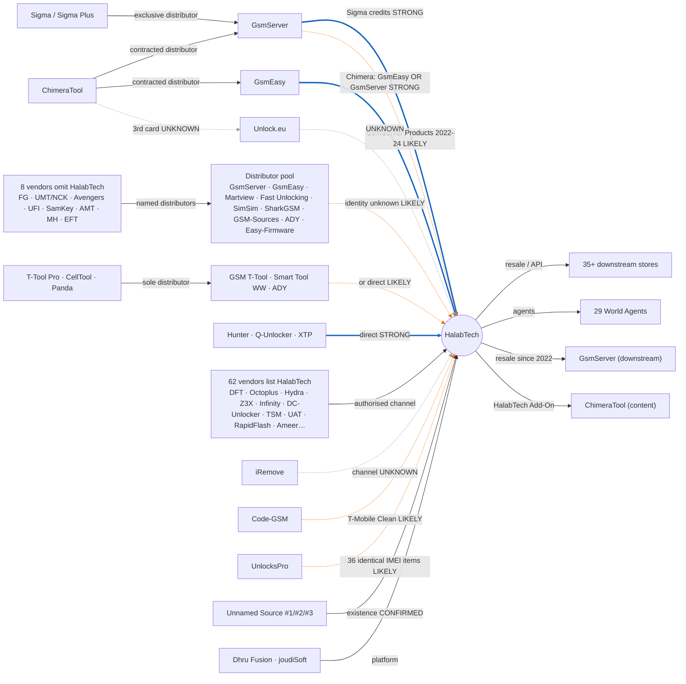

# حلب تك (HalabTech): تحقيق سلسلة التوريد، الجولات 4 إلى 6 (تاريخ التحقق: 2026-10-11)

> تكمّل هذه الجولات تقرير الجولات 1–3 (`reports/prior/HalabTech_Report_R1-R3.md`). كل الأرقام بين معقوفين `[EV-xxx]` و`[REL-xxx]` تحيل إلى ورقتي "Evidence Register" و"Supply Chain Relationships" في المصنّف `HalabTech_Complete_Supply_Chain_Research.xlsx`.

## الخلاصة

- **لم يثبت علناً أي مورّد API مباشر مسمّى.** لكن حلب تك نفسه يكتب في أسماء خدماته أن طلبات IMEI تُوزّع على ثلاثة مصادر مرقّمة على الأقل ("Source 1#" و"Source 2#" و"Source 3#")، ومعها مزوّدون يسمّيهم "Server Direct" و"Direct Source". لا يذكر اسم أيّ منها \[EV-055]\[REL-099].
- **أربع علاقات توريد صارت STRONG.** مصدرها قواعد بيع يعلنها المطوّرون أنفسهم، وليس طلبات أو اتصالات API مرصودة:
  1. **Sigma ← GsmServer ← حلب تك.** تقول SigmaKey إن الترخيص يُباع "through our exclusive distributor GsmServer"، وإن الوكلاء يشحنون رصيدهم من gsmserver.com \[EV-070]\[REL-027].
  2. **Chimera ← GsmEasy أو GsmServer ← حلب تك.** تقول ChimeraTool: "resellers can only buy credits from them". وحلب تك وكيل عادي لدى Chimera وليس موزعاً \[EV-140]\[REL-025].
  3. **Hunter Unlocker وQ-Unlocker ← حلب تك مباشرة.** يقول المطوّران "we do not have direct sales to agents"، ويسمّيان حلب تك أحد ثلاثة موزعين عالميين \[EV-097]\[EV-098]\[REL-084].
  4. **XTP – Xiaomi Tool Pro ← حلب تك مباشرة.** حلب تك هو "Official Main Seller" لهذه الأداة \[EV-166]\[REL-085].
- **مرشّحو IMEI بدرجة LIKELY:**
  - **Code-GSM** لخدمة T-Mobile "Clean & Paid Off". أسماء الخدمات متطابقة حرفياً، وسعر حلب تك أعلى بـ$1–3 في الفئات 15/16/17. لكن أسعار صفحة القائمة تناقض الفئات الأدنى \[EV-121]\[EV-197].
  - **UnlocksPro** لعدّة مجموعات IMEI. يصف نفسه بأنه "Main/Direct Source"، ويطابق حلب تك في 36 اسماً بما فيها أرقام داخلية. اتجاه النسخ بينهما لم يُثبت \[EV-123]\[EV-195].
- **ثمانية مطوّرين يسقطون حلب تك من قوائمهم الكاملة**، مع أنه يبيع منتجاتهم: Furious Gold وUMT/NCK وAvengers وUFI وSamKey وAMT وMH Unlocker وEFT. وجود وسيط بينهم وبين حلب تك صار LIKELY، وهويته غير معروفة \[REL-086…093].
- **51 مطوّراً جديداً يذكرون حلب تك رسمياً**، فصار المجموع 62 بعد أن كان 11. هذا يثبت قناة بيع مرخّصة فقط، ولا يثبت اتصال API.

---

## 1. الأدوات المستخدمة واختبارها

| الأداة | الاختبار الأول | الاستدعاءات (الجولات 4–6) | الإخفاقات |
|---|---|---|---|
| Firecrawl (scrape + search) | ناجح: `server.halabtech.com/pages/DISTRIBUTOR` | scrape ×62، search ×30 | 20 (أغلبها تجاوز حد 18 طلباً/دقيقة المشترك بين الوكلاء) |
| Parallel Search (search + fetch) | ناجح: قائمة موزعي EFT | search ×47، fetch ×29 | 1 |
| Exa (search + fetch) | ناجح: صفحات وكلاء تذكر حلب تك | search ×15، fetch ×28 | 1 (+ صفحات JavaScript فارغة أُعيد جلبها بـ Firecrawl) |

- مجموع الاستدعاءات المسجّلة: **211**. التفصيل لكل مسار بحث في ورقة "MCP Tool Log".
- `curl` المباشر من البيئة محجوب بالبروكسي (403)، فمرّ كل الوصول إلى المواقع عبر الأدوات الثلاث.
- **منهجية العمل:** خمسة وكلاء بحث متوازين، ثم تحقق مستقل في الجولة 6 بأداة مختلفة عن الأداة التي أنتجت الدليل.
  - A1: قوائم المطوّرين الكبار.
  - A2: الأدوات الصغيرة.
  - B: بصمات IMEI.
  - C: الوسطاء والأرشيف.
  - D: قنوات حلب تك نفسها.

## 2. فهرس الخدمات الكامل (الأولوية B)

- **الحجم:** سحب Firecrawl الصفحتين العامتين كاملتين. صفحة Server فيها **321 مجموعة و985 خدمة**، وصفحة IMEI فيها **62 مجموعة و470 خدمة**. المجموع **383 مجموعة و1,455 خدمة**، وكلها في ورقة "All Services" بأسعارها ومدد تسليمها \[EV-054]\[EV-055].
- **المقارنة التاريخية:** في 16-12-2022 كان فهرس Server يضم 385 مجموعة و1,705 خدمات. وفي 24-03-2023 كان فهرس IMEI يضم 51 مجموعة و660 خدمة. الفهرس انكمش منذ 2022 \[EV-156].
- **المنصة:** تذييل الصفحات يقول "Powered by Dhru Fusion" مع رابط إحالة `fromaid=server.halabtech.com`. صار ذلك CONFIRMED بعد أن كان LIKELY \[EV-053].
- **معرّف الخدمة العام:** صفحات المنتجات الفردية تحمل `?pid=`، مثل DFT PRO 2 Year برقم 4113. لكن ثلاث صفحات فقط مفهرسة علناً، وصفحات السلة تُحمَّل بـ JavaScript، فبقي الجمع الشامل للمعرّفات مهمة للجولة التالية \[EV-058].

| الفئة (Server) | مجموعات | خدمات | | الفئة (IMEI) | مجموعات | خدمات |
|---|---|---|---|---|---|---|
| تراخيص/كريديت أدوات برمجية | 231 | 512 | | فحص IMEI/GSX | 7 | 132 |
| تفعيل بوكسات ودونغلات | 40 | 187 | | إزالة حسابات/MDM | 5 | 77 |
| مخططات وبرامج صيانة | 18 | 67 | | إصلاح شبكة سامسونج (CPID) | 5 | 61 |
| بطاقات هدايا وألعاب | 8 | 63 | | iCloud FMI OFF | 2 | 60 |
| عتاد فعلي (Box & Dongle) | 1 | 40 | | أكواد OEM | 19 | 56 |
| اشتراكات رقمية وAI | 5 | 38 | | فك شبكات (IMEI) | 18 | 54 |
| منصات واستضافة واختبار | 8 | 31 | | FRP | 2 | 17 |
| شحن اتصالات (سوريا/تركيا) | 5 | 18 | | خدمات عن بُعد | 4 | 13 |
| منتجات حلب تك | 4 | 15 | | | | |
| مشاركة بوكسات عن بُعد | 1 | 14 | | | | |

- **التنفيذ الآلي:** 31 مجموعة Server و3 مجموعات IMEI موسومة "AUTO API".
- **التوزيع على مصادر:** 6 مجموعات IMEI تحمل وسوم "Source #n" أو "Direct".
- **التنفيذ الداخلي:** 7 مجموعات تُنفَّذ داخلياً، مثل العضويات وطلبات الملفات و"Sharing Box" الذي يشارك بوكسات يملكها حلب تك فعلياً \[EV-057].

## 3. المورّدون والعلاقات المكتشفة حديثاً (الأولوية A)

### 3.1 GsmServer: من "مجهول" إلى مورّد وسيط قوي في خطوط محددة
- **Sigma:** GsmServer هو **الموزع الحصري**. على الوكلاء شراء كريديت Sigma Plus من gsmserver.com بسعر $0.83–0.87 وحد أدنى 1,000. تحقق المسار A1 من ذلك، وأعادت الجولة 6 الجلب بأداة Parallel. التقييم: **STRONG** \[EV-070]\[EV-191].
- **Chimera:** GsmServer أحد الموزعَين المتعاقدَين مع Chimera \[REL-025].
- **"GsmServer Products":** بين 2022 و2024 كان في فهرس حلب تك مجموعة بهذا الاسم تضم Boot-Loader 2.0 وGB Key وحزم Smart Clip، وهي غير موجودة اليوم. يُظهر ذلك أرشيف 16-12-2022، وأعدنا قراءة اللقطة الخام في الجولة 6. التقييم: **LIKELY** \[EV-146]\[EV-200].
- **أدوات أخرى:** GsmServer موزع أيضاً لـ Hydra (وكيل ترخيص عالمي) وZ3X (بطاقات بديلة حصراً) وCheetah وFurious Gold وUMT وAvengers وInfinity. وأطلق في 09-09-2026 واجهة API متوافقة مع DHRU Fusion Pro \[EV-147].
- **ما لم يثبت:** لا يوجد دليل على اتصال API فعلي بين GsmServer وحلب تك. والعلاقة في الاتجاه المعاكس مثبتة: GsmServer يعيد بيع منتجات حلب تك منذ 14-10-2022.

### 3.2 Chimera: تصحيح الصفة وإثبات الوسيط
- **قاعدة البيع:** وثيقة "Resellers Sales System" تقول: "We have two distributors currently: GsmEasy and GsmServer… resellers can only buy credits from them… The circle of distributors will not be expanded". قُرئت كاملة وأُعيد التحقق منها \[EV-140]\[EV-193].
- **صفة حلب تك:** بطاقته في صفحة الوكلاء بلا وسم "Distributor"، ولقطة 2023 تصفه بـ "HALABTECH (reseller)" وجهة اتصاله "Hosam" \[EV-143].
- **مفارقة 2022:** حلب تك باع آنذاك "Chimera Credit & Activation (Min 20000 Credits) [Reseller Package]" بسعر $0.112 ثم $0.101. هذه كمية مستوى الموزعين، ما يرجّح أنه اشتراها من GsmEasy أو GsmServer \[EV-145].
- **تناقض:** الصفحة الحية تعرض بطاقة "Distributor" ثالثة هي Unlock.eu، خلافاً لنص "موزعَين اثنين" (CL-021).

### 3.3 توريد مباشر من المطوّر: أقوى الحالات
| الأداة | الدليل | التقييم |
|---|---|---|
| Hunter Unlocker Pro | "contact one of the official distributors only, we do not have direct sales to agents"، وحلب تك "WorldWide Distributor" | STRONG \[EV-097]\[EV-192] |
| Q-Unlocker Pro | السياسة نفسها، وحلب تك أحد ثلاثة موزعين | STRONG \[EV-098] |
| XTP – Xiaomi Tool Pro | "Official Main Seller: HalabTech"، ومُدرج أولاً موزعاً عالمياً | STRONG \[EV-166] |
| Infinity/CM2 | "7. Distributor – HALABTECH" | الصفة CONFIRMED، والتوريد المباشر LIKELY \[EV-067]\[EV-199] |
| Hydra | وكيل دونغل (سوريا، تركيا) ووكيل ترخيص (العراق، الأردن، السودان، سوريا، تركيا) | الصفة CONFIRMED، والتوريد المباشر LIKELY \[EV-063] |

### 3.4 مطوّرون يسقطون حلب تك: وسيط مرجّح وهويته مجهولة
| المنتج | الموزعون المعلنون | التقييم |
|---|---|---|
| Furious Gold | GSM Server، GsmEasy، GsmFastest، ADYunlocker، HACK3R2K، Click-Unlocker، acellsorios | LIKELY \[EV-075] |
| UMT / NCK | Fast Unlocking، GsmServer، GsmEasy، Martview، GSM Sources، SharkGSM، SimSim | LIKELY \[EV-076] |
| Avengers Box | Fast Unlocking، GsmServer، GSM-Sources، GsmEasy، GsmSalman، Smart Unlock Mobile، Gsm Africa | LIKELY \[EV-077] |
| UFI Box | Martview (موزع عالمي) | LIKELY \[EV-078] |
| SamKey | GsmEasy، SiRoYa | LIKELY \[EV-216] |
| AMT | GSM Credit، GsmGenesis، Ady Unlocker | LIKELY \[EV-217] |
| MH Unlocker Pro | iUnlocking Store (موزع أعلى)، GsmFastest، Gsm Africa، Leope-Gsm، Infinity-Box | LIKELY \[EV-218] |
| EFT Dongle/Pro | ذراع Easy-Firmware وتسعة موزعين عالميين (SimSim، GsmServer، GSM-Sources، SharkGSM، GsmEasy، GsmFastest، KhaledGsm…) | LIKELY \[EV-149] |

**مطوّرون لهم موزع وحيد:**
- **T-Tool Pro:** موزعه الوحيد GSM T-Tool في العراق، وحلب تك "#2 Worldwide Reseller".
- **CellTool:** موزعه الوحيد Smart Tool Worldwide.
- **Panda Tools:** موزعه الوحيد ADY Unlocker.

التقييم للثلاثة: LIKELY أن الوسيط هو ذلك الموزع، أو أن الشراء مباشر \[REL-094…096].

### 3.5 خدمات IMEI وiCloud وMi Account (الفجوة الأعلى)
- **Code-GSM** (code-gsm.com، المالك Wajih Boukadida، كندا/تونس، يصف نفسه "Wholesale Supplier" في GSM-Forum):
  - أسماء خدمة T-Mobile "Clean & Paid Off" ووصف السياسة متطابقة حرفياً مع حلب تك.
  - صفحات التفاصيل: Till 15 بـ $43.99 وTill 16 بـ $63.45 وTill 17 بـ $79.49. سعر حلب تك: $44.99 و$66.45 و$82.49.
  - **تناقض (الجولة 6):** صفحة القائمة لدى Code-GSM تعرض Till 11/12 بـ $45 وTill 13/14 بـ $60، وهي **أعلى** من سعر حلب تك لـ Till 12/14 ($38.99). لذلك يبقى المرشّح LIKELY للفئات العليا فقط، والفئات الأدنى DISPUTED \[EV-121]\[EV-197]\[CL-013].
- **UnlocksPro** (unlockspro.com):
  - يصف نفسه "We are Main/Direct Source Many Services"، وأسعاره بثلاث فئات: DISTRIBUTORS / WEB OWNER / RESELLER.
  - التطابق مع حلب تك 36 اسماً، منها اسم المجموعة "Infinix Tecno Itel MDM Source 1# [Premium]"، وأدوات Signal Labs بأرقامها (#26234/#26235/#26267/#26268)، وخدمات JDM V4/V5 (#22343–22349) مع وسم "Patch 1.7.2023"، وخدمة Reseller Flex "[DIRECT SOURCE]".
  - اتجاه النسخ غير مثبت. التقييم: LIKELY \[EV-123…126]\[EV-195].
- **المصدر #1 لـ MDM Tecno/iTel/Infinix:** يقول حلب تك "We are the direct source for Premium Services… Premium Source #1"، ويعرض في المنشور نفسه "SOURCE #2" أرخص. التقييم: ادعاء ذاتي LIKELY \[EV-162]\[EV-198].
- **iRemove:** يدير برنامج شراكة عبر DHRU API منطقة وكلائه مغلقة بتسجيل دخول. أسعار حلب تك أعلى من سعر iRemove العام بـ $25–70 (مثلاً iPad13,18: $150 مقابل $100). القناة UNKNOWN \[EV-133].
- **بصمات GSX:** الرقمان "#225" و"#33225" يبدوان أرقام خدمات من سيرفر أعلى بقيت في الأسماء. استُبعد sickw.com، والأصل لم يُعرف \[EV-056]\[EV-130].
- **"Zeus" (تصحيح):** منشور 2023 "ZEUS DOWN ON OUR SERVER / SEND ON HEMRES" لا يسمّي مورّد جملة. Zeus وHermes وScylla وKratos أدوات iOS باعها حلب تك، والمنشور يحوّل الزبائن من أداة إلى أخرى \[EV-194]\[CL-012].
- **تحذير منهجي:** أغلب السيرفرات التي تحمل نصوص حلب تك نفسها هي **زبائنه**، وليست مورّديه. مثال ذلك عبارة "انتببه للوصف" بخطئها الإملائي، واسم مجموعة GSX المكتوب بحروف لاتينية عن العربية \[EV-131]\[EV-132].

### 3.6 قوائم المطوّرين الجديدة (51 مطوّراً، CONFIRMED أو STRONG)
- **موزع:** HW-Key، DeviceSavior، OumseGsm (أحد اثنين)، TSM Tool، Pragmafix، MobileSea، UNI-Android (UAT)، RTC Tool، KG Killer، Galaxy Multi Tool، Hello AIO، Xiaomi Pro Tool، Piranha (قبل GsmServer)، MG Unlocker، FlexUnlock (BIG Distributor)، KGFRP، Ghost Auth، WorldWideAuth، Ameer Tool (GSMUNBRICK)، Infinity، EMT، XinZhiZao ("Middle east Statewide Distributor")، MWorker، Global Auth Tool، S-Finder، AnonySHU، FRP Service Tool، XTP، Hunter، Q-Unlocker.
- **وكيل:** Z3X (سوريا، تركيا، لبنان، ألمانيا)، Hydra، DC-Unlocker، Sigma، Cheetah (وكيل وليس موزعاً، CL-015)، Griffin، Phoenix Service Tool، Global Unlocker Pro، TR Tools، KEY-Tool، T-Tool Pro، Scorpion، AWT، CellTool، M-PRO، Flame Auth، GPT-PRO، Xiaomi BD Auth، Panda Tools، SK Unlocker، DZKJ.
- التفاصيل في ورقة "Original Vendors" (VEN-016 إلى VEN-080).

### 3.7 المصبّ والتوريد العكسي
- **حلب تك مورّد API للآخرين.** يعلن "Connect API NOW"، ويطلب من عملائه "please sync api" بعد كل تغيير سعر \[EV-183].
- **35+ متجراً تعيد البيع:** منها WARD Server وIDUnlocker وMR Unlockers وGSMUnlockInfo وGsmUnlockingStore وGSM Manager ("Instant - Auto Api") وSuperUnlockMx \[REL-103].
- **وكلاء العالم:** صفحة World Agents تضم 29 وكيلاً، منها ADY Unlocker وGSMFastest وGsmServer وMyGSM24 و3GSM وBee Unlock \[EV-176].
- **مصادر الفيرموير:** حلب تك يعلن أنه يريد **شراء** وصول رسمي إلى مصادر فيرموير BLU وZTE وMeizu وASUS وHuawei (جهة الاتصال Mohamad Al-Soliman) \[EV-184].

## 4. حسم العلاقات العالقة من الجولات السابقة (الأولوية C)

| البند | النتيجة | التقييم |
|---|---|---|
| GsmServer كمورّد أعلى | قوي لـ Sigma، ومشترك مع GsmEasy لـ Chimera، ومرجّح لـ "GsmServer Products" (2022–2024)، ولا دليل API | STRONG / LIKELY |
| سلسلة توزيع EFT | القائمة الكاملة (آخر تعديل 16-12-2022) لا تذكر حلب تك، والوسيط مجهول الهوية | LIKELY (وسيط) |
| RapidFlashTool | "HalabTech – Distributor (Worldwide)" أولاً في reseller.php، والمطوّر غير مسمّى في الصفحة | CONFIRMED (الصفة) \[EV-150] |
| WARD Server | زبون مصبّ يبيع "HalabTech Support Subscriptions" | CONFIRMED \[EV-153] |
| GSMMUNNA / DZGSM / FirmwareDrive / FirmwareWorld | مواقع فيرموير منافسة، ولا رابط بحلب تك | UNKNOWN (لا علاقة) \[EV-159] |
| Amir Tech / Ameer Tool | Ameer Tool من فريق GSMUNBRICK (سوريا)، وحلب تك "Distributor/Reseller WorldWide"، و"Amir Tech" بلا صلة معروفة | محسوم \[EV-120]\[EV-151] |

## 5. التحقق المستقل (الجولة 6) والتصحيحات

- **أُعيد جلبه بأداة ثانية وثبت حرفياً:**
  - اقتباس Sigma (Parallel) \[EV-191].
  - اقتباس Hunter (Parallel) \[EV-192].
  - وثيقة Chimera (Parallel) \[EV-193].
  - صفحة Infinity (Parallel) \[EV-199].
  - وصف UnlocksPro لنفسه (Exa) \[EV-195].
  - نص "We are only a reseller" على news.halabtech.com (Exa)، وهو نص قالب عام قليل الوزن \[EV-196].
  - منشور "direct source" (Parallel) \[EV-198].
  - لقطات الأرشيف الخام لـ "GsmServer Products" وباقة Chimera \[EV-200].
- **التصحيحات** (ورقة "Conflicts and Corrections"، CL-009 إلى CL-021):
  - حلب تك وكيل لـ Chimera وليس موزعاً.
  - الفهرس 383 مجموعة، وليس "≥240".
  - Service ID مكشوف في صفحات المنتجات.
  - Zeus أداة وليس مورّداً.
  - أسعار Code-GSM متنازع عليها.
  - Cheetah وكيل وليس موزعاً.
  - Scorpion: الصفحة الحية هي المرجع.
  - Ameer Tool محسوم.
  - لا يوجد SKU لـ AuthFlash.

## 6. مخطط سلسلة التوريد المحدّث

الصورة: `reports/supply_chain_graph_R6.png`، والمصدر: `reports/supply_chain_graph_R6.mmd`.

- **مفتاح الخطوط:** متصل = CONFIRMED، سميك = STRONG، متقطع برتقالي = LIKELY، متقطع رمادي = UNKNOWN.
- خط "Vendor → HalabTech" يعني صفة بيع مرخّصة فقط، ولا يعني اتصال API.

## 7. التقدّم منذ الجولة 3

| المجال | الجولة 3 | الجولة 6 |
|---|---|---|
| تغطية الفهرس | ≥240 مجموعة و34 سجلاً | 383 مجموعة و1,455 خدمة، مع ربط كل مجموعة بمطوّر ومرشّح |
| المنصة | Dhru مرجّح | Dhru مثبت (التذييل) |
| المطوّرون الذين يذكرون حلب تك | 11 | 62 |
| قوائم مطوّرين تُسقطه | 0 مؤكدة | 8 |
| علاقات توريد STRONG | 0 | 4 |
| علاقات وسيط/مورّد LIKELY | 4 (مباشر من المطوّر) | 14 |
| مجموعات لها مرشّح أعلى (≥ LIKELY) | ~15 | 96 من 383 |
| GsmServer كمورّد | UNKNOWN | STRONG (Sigma)، مشترك (Chimera)، LIKELY (2022–24) |
| EFT | UNKNOWN | وسيط LIKELY |
| IMEI | لا مرشّح | مصادر مرقّمة مثبتة، وCode-GSM وUnlocksPro LIKELY |
| الخيوط القديمة (WARD، GSMMUNNA، DZGSM…) | لم تُفحص | كلها مصنّفة |
| التاريخ (Wayback) | لم يُفحص | 8 لقطات بين 2021 و2024 |
| سجلات الأدلة | 53 | 266 |
| مورّدو API مسمّون ومثبتون | 0 | 0 |

## 8. المورّدون غير المحسومين مرتّبين حسب الأهمية

| # | الخدمات | عدد SKU | المرشّحون | التقييم الحالي |
|---|---|---|---|---|
| 1 | فك شبكات IMEI (T-Mobile، Reseller Flex، شبكات أخرى) | 54 | Code-GSM، UnlocksPro، مصادر Premium مجهولة | LIKELY |
| 2 | MDM وID لـ Tecno/iTel/Infinix (المصدر #1/#2/#3) | 18 | حلب تك ذاته (#1)، UnlocksPro، و#2/#3 مجهولان | مثبت التعدد، والهوية UNKNOWN |
| 3 | إصلاح شبكة سامسونج CPID (EDL، JDM، V1–V3) | 61 | UnlocksPro (JDM)، Best4unlock (EDL) | LIKELY / UNKNOWN |
| 4 | iCloud FMI OFF للآيباد والساعة | 60 | برنامج شراكة iRemove أو شريك وسيط | UNKNOWN |
| 5 | Xiaomi Mi Account | 62 | "Server Direct" و"Direct Source"، UnlocksPro | UNKNOWN |
| 6 | Chimera | 5 | GsmEasy أو GsmServer (أو Unlock.eu) | STRONG للوسيط، والهوية UNKNOWN |
| 7 | EFT | 7 | ذراع Easy-Firmware أو 9 موزعين | LIKELY |
| 8 | UMT / NCK / Avengers | 13 | 7 موزعين معلنين | LIKELY |
| 9 | Furious Gold | 30 | 7 موزعين معلنين أو متجر المطوّر | LIKELY |
| 10 | Sigma | 5 | GsmServer | STRONG |
| 11 | فحوص GSX وApple | 132 | مصدر بأرقام #225/#33225 | UNKNOWN |
| 12 | بطاقات هدايا وألعاب | 63 | — | UNKNOWN |
| 13 | شحن اتصالات سوريا/تركيا | 18 | — | UNKNOWN |
| 14 | اشتراكات AI ورقمية | 38 | — | UNKNOWN |
| 15 | SamKey / AMT / MH Unlocker | 9 | موزعون معلنون | LIKELY |
| 16 | Cheetah | 6 | مباشر أو 8 موزعين | UNKNOWN |
| 17 | نحو 150 أداة صغيرة لم تُفحص | ~330 | — | UNKNOWN |
| 18 | برامج مخططات بلا قوائم علنية | ~40 | — | UNKNOWN |
| 19 | عتاد فعلي | 40 | Martview، GsmServer… | UNKNOWN |

## 9. مهمة البحث التالية

الملف الكامل مع الأسئلة والاستعلامات والموجّه الجاهز: `reports/NEXT_RESEARCH_MISSION_R7.md`. أهم الأسئلة:
1. أيّ موزع لـ Chimera يورّد لحلب تك؟
2. مقارنة أسعار Code-GSM وحلب تك في يوم واحد لكل الفئات.
3. اتجاه التطابق بين UnlocksPro وحلب تك، عبر تواريخ الظهور في الأرشيف وTelegram.
4. هل حلب تك شريك iRemove؟
5. حساب سعر الكلفة من الأسعار ذات الخانات العشرية الثلاث (مثلاً 15.125 = 13.75 × 1.10) ومطابقته مع قوائم الموزعين.
6. أيّ قناة EFT؟
7. جمع معرّفات pid لكل الخدمات.

## 10. حدود وتحفّظات

- **قواعد البيع ليست أوامر شراء.** كل علاقات STRONG مبنية على ما يعلنه المطوّرون، ولم يُرصد أي طلب أو اتصال API فعلي، فهذا غير ممكن علناً.
- **تشابه الأسماء والأسعار مؤشر وليس دليلاً.** أغلب السيرفرات التي تحمل نصوص حلب تك زبائنه.
- **صفحات غير موثوقة الملكية:** قائمة Borneo على borneoseller.com لم تُؤكَّد ملكيتها للمطوّر، وقائمة DZKJ قد تتغيّر حسب موقع الزائر.
- **ما لم يُفحص:** صفحة UnlockTool الرسمية ما زالت تحجب الروبوتات. وحدّ Firecrawl المشترك سبّب 20 إخفاقاً أُعيد معظمها بأدوات أخرى.
- **لا معلومة علنية** عن الكيان القانوني لحلب تك.

## المصادر الرئيسية

1. https://server.halabtech.com/resellerpricing/server — https://server.halabtech.com/resellerpricing/imei (Firecrawl، 2026-10-11)
2. https://server.halabtech.com/pages/DISTRIBUTOR (تذييل Dhru)
3. https://sigmakey.com/en/content/15258/
4. https://chimeratool.com/en/docs/resellers-sales-system — https://chimeratool.com/en/resellers?featured=1
5. https://web.archive.org/web/20221216161524/https://server.halabtech.com/resellerpricing/server
6. https://web.archive.org/web/20220117015629/https://server.halabtech.com/resellerpricing/server
7. https://web.archive.org/web/20230111154911/https://chimeratool.com/en/resellers
8. https://www.hunter-unlocker.com/Home/Reseller — https://www.q-unlocker.com/Home/Reseller
9. https://t.me/halabtech2/36505 (XTP) — https://t.me/halabtech2/39429 و https://t.me/s/halabtech2?before=39432 (direct source)
10. https://infinity-box.com/buy — https://ftp.hydradongle.com/agents/0 — https://z3x-team.com/where-to-buy — https://www.dc-unlocker.com/plug/dealers.php?cc=SY&cw=1
11. https://www.furiousgold.com/en/distributors — https://umt-pro.com/?page_id=74 — https://avengersbox.com/resellers — https://www.ufi-box.com/pages/distributors-and-resellers
12. https://samkey.org/resellers — https://www.androidmultitool.com/resellers — https://www.mhunlocker.com/Resellers.html
13. https://eft-dongle.easy-firmware.com/distributor-reseller
14. https://www.code-gsm.com/home/servicedtl/t-mobile-sprint-metropcs-policy-usa-iphone-till-15-series-clean-amp-paid-off-onl — https://www.code-gsm.com/home/imei_services
15. https://unlockspro.com/index — https://unlockspro.com/resellerpricing/imei
16. https://iremove.tools/ipad-fmi-off-service
17. https://www.rapidflashtool.com/reseller.php — https://gsmunbrick.com/ameer-tool/where-to-buy
18. https://t-tool-pro.net/our-resellers — https://svr1.samsungtool.us/ — https://www.panda-tools.net/resellers/
19. https://t.me/s/halabtech2?before=25390 (Zeus/Hermes)
20. https://support.halabtech.com/index.php?a=pages&b=world-agents — https://wardserver.com/resellerpricing/server
21. https://gsmserver.com/en/articles-and-video/new-gsmserver-api-for-dhru-fusion-pro/

القائمة الكاملة (266 دليلاً) في ورقة "Evidence Register"، وكل دليل جديد مربوط بملف المسار الذي أنتجه في `data/findings/`.
