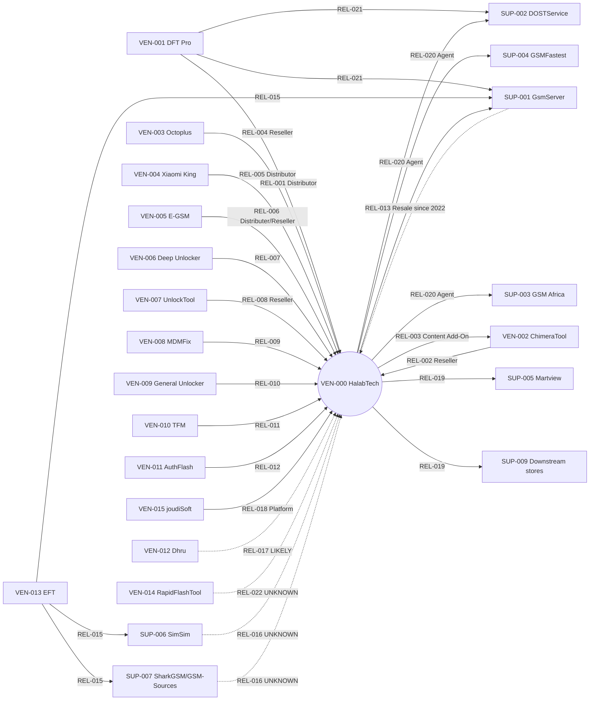

# حلب تك (HalabTech): تحقيق في سلسلة توريد خدمات GSM، الجولات 1 إلى 3 (تاريخ التحقق: 2026-10-11)

حلب تك مجمّع وموزّع جملة لخدمات GSM. يعمل عبر سيرفر بنمط Dhru (server.halabtech.com) فيه ما لا يقل عن 240 مجموعة خدمات "Server".\[1\]\[2\] أحد عشر مطوّراً أصلياً يذكرونه بالاسم في صفحات الموزعين والوكلاء على مواقعهم الرسمية. لكن لم يثبت علنياً أي مورّد API مباشر يُنفّذ طلباته. الحالة الوحيدة المؤكدة لعلاقة في الاتجاهين هي مع GsmServer، وهي علاقة بيع متبادل بين نظراء وليست توريداً من GsmServer إلى حلب تك.

## TL;DR
- **ما ثبت:** 11 مطوّراً أصلياً يذكرون حلب تك موزعاً أو وكيلاً رسمياً على مواقعهم الرسمية: DFT Pro وChimeraTool وOctoplus وXiaomi King Tool وE-GSM وDeep Unlocker وUnlockTool (كوكيل) وMDMFix وGeneral Unlocker وTFM Tool وAuthFlash. هذا يثبت قناة بيع مرخّصة فقط، ولا يثبت اتصال API مباشراً. بل إن وثيقة "Resellers Sales System" لدى ChimeraTool تقول: "We have two distributors currently: GsmEasy and GsmServer… resellers can only buy credits from them"، بحد أدنى 20,000 كريديت. معنى ذلك أن كريديت Chimera يصل حلب تك على الأرجح عبر GsmEasy أو GsmServer لا من المطوّر مباشرة (مصدر هذا الاقتباس مقتطف بحث).
- **ما لم يثبت:** لم يظهر في أي مصدر علني اسم الطرف الذي ينفّذ طلبات حلب تك تقنياً. المجموعات الموسومة "AUTO API" تؤكد أن التنفيذ آلي، لكن المورّد غير مسمّى. نحو 225 مجموعة من أصل أكثر من 240 ما زال مورّدها الأعلى مجهولاً، ومنها خدمات IMEI وiCloud وبطاقات الألعاب.
- **GsmServer:** علاقة نظراء في الاتجاهين. GsmServer يبيع باقات حلب تك منذ 14.10.2022، وحلب تك يدرجه ضمن "وكلائه حول العالم"، لكن لا دليل على أنه يورّد لحلب تك أدوات طرف ثالث.\[3\] وفي المقابل، حلب تك نفسه مورّد محتوى لـ ChimeraTool عبر "HalabTech Add-On".

---

## 1. Key Findings (ملخص تنفيذي)

1. **نموذج العمل:** حلب تك منصة متعددة الأذرع. **server.halabtech.com** متجر جملة للتفعيلات والكريديت وفك الشبكات وiCloud وبطاقات الألعاب وحسابات الذكاء الاصطناعي وتراخيص Dhru.\[1\] **support.halabtech.com** مستودع فيرموير بعضوية مدفوعة.\[4\] وهناك أيضاً **tools.halabtech.com** (أداة Halabtech Tool) و**store.halabtech.com** و**news.halabtech.com**.\[5\]\[6\] والموقع يدعو المطورين صراحةً: "If you're Source or Tool owner, contact us for a deal".\[1\]
2. **المنصة التقنية:** ثبت أن support.halabtech.com يعمل على **Real Easy Store** من joudiSoft، والتذييل يقول ذلك صراحة.\[4\] أما اعتماد server.halabtech.com على **Dhru Fusion** فمرجّح بقوة (LIKELY): بنية الروابط (/resellerpricing/server)، وبيع "Dhru Fusion New License" بـ$605، و"Cron Jobs For Your Server (DHRU)".\[2\] لم نجد تذييل "Powered by Dhru".
3. **الصفة الرسمية:** 11 مطوّراً يذكرون حلب تك، والمسمّيات غير متّسقة: "Distributor" عند Xiaomi King وTFM، و"Distributor/Reseller" عند Deep Unlocker، و"Distributor And Reseller" عند DFT Pro، و"Distributer" على egsmtool.com مقابل "Reseller" على egsmkey.com، و"Reseller" عند UnlockTool.\[7\]\[8\]\[9\]\[10\]\[11\]\[12\]\[13\]\[14\]
4. **التوريد العكسي:** حلب تك **مورّد محتوى** أيضاً. ChimeraTool تصف الإضافة بأنها "our collaboration with the Halabtech team"، وقال مدير منتج Chimera في GSM-Forum: "These are not our firmwares, but HalabTech firmwares".\[15\]\[16\]
5. **شبكة البيع اللاحقة:** 15 متجراً على الأقل تعيد بيع كريديت حلب تك أو باقاته، منها GsmServer وMartview وAll-Spares وCleanUnlocker وSaudi-GSM وGSM Africa وRGSM Rio (التي تسمّيه "Halabtech [Official Distributor]").\[17\]\[18\]\[19\]\[20\]\[21\]\[22\]\[23\]\[24\]\[25\]
6. **فجوة التوريد الأعلى:** لم يكشف أي مصدر علني المورّد الفعلي لخدمات IMEI (T-Mobile/Sprint، وiREMOVE، وMi Account) ولا لأغلب أدوات "Auth" الصغيرة. وتشابه الأسعار لا يُعدّ دليلاً على مورّد مشترك.

---

## 2. Details: التقرير الاستخباراتي (بالعربية)

### 2.1 نموذج عمل حلب تك
- **مجمّع جملة:** أكثر من 240 مجموعة منتجات، من أدوات Auth بنحو $1 للكريديت إلى Chimera وOctoplus وZ3X وHydra وUMT وCM2، ثم شحن Syriatel وMTN سوريا وTurkcell، وiTunes وGoogle Play وPUBG UC، وحسابات ChatGPT وClaude وCursor.\[2\]
- **برنامج وكلاء مدفوع (مدى الحياة، يُضاف رصيداً):** Reseller بـ$299، وBig Reseller بـ$499، وWeb Owner بـ$1,999، وDistributor بـ$2,999 مع "Maximum Discount".\[26\]
- **منتجات خاصة:** عضويات الفيرموير (Platinum 12 شهراً بـ$59.99)، و"HalabTech Credits" بـ$1، وأداة Halabtech Tool v1.1.\[2\]\[5\]\[27\] مراجعات iMobie وMobiKin لهذه الأداة صفحات تسويق SEO، وأرقامها (ترخيص سنوي $50–70) غير موثّقة.\[28\]\[29\]
- **مؤشرات الحجم:** صفحة فيسبوك (facebook.com/HalabTech.official.page) فيها 78,477 متابعاً و"96% recommend (240 reviews)"، وتُدرج قناتي telegram.me/HTSupport وt.me/halabtech2. وفي Trustpilot حصل server.halabtech.com على "TrustScore 4 out of 5 · 4.1 · 75 reviews"، مع تنبيه الموقع: "This company hasn't invited their customers, so reviews may not be representative". بلد التواصل المسجّل هناك "United States"، ونسختا nz/au تعرضان أرقاماً أقدم (4.5 من 58–59 مراجعة). أرقام الهاتف: سوري +963992951910، وتركي +90507058173، وسوداني +249116472371.\[6\]\[8\]

### 2.2 تحليل المنصة التقنية
- وثائق Dhru تؤكد أن Fusion يتيح: "Connect multiple providers, compare pricing, route orders by rule"، والاتصال بسيرفر Dhru آخر "as a client"، وخيار "Verify before sending to supplier".\[30\]\[31\]\[32\]
- **الاستنتاج:** وسم "AUTO API" (Mysterio وTSM وMDMFix وFenix وPUBG UC) يدل على تنفيذ آلي، لكنه **لا يكشف** المورّد. وجود مجموعة "API Test" يؤكد أن ربط API مفعّل.\[2\]
- حلب تك يبيع "Dhru Fusion Supplier panel" بـ$220.5،\[2\] لكن لم نعثر على قائمة موزعين رسمية في dhru.com تذكره، فصفة "موزع Dhru" تبقى ادعاءً ذاتياً.

### 2.3 فهرس الخدمات
- **IMEI:** T-Mobile/Sprint/MetroPCS Policy USA من $38.99 إلى $82.49، وiREMOVE FMI OFF للآيباد من $120 إلى $160، وXiaomi Mi Account (اليابان $13.99، هولندا $18).\[33\]
- **Server:** ما لا يقل عن 240 مجموعة، سُجّل منها 34 سجلاً تمثيلياً في الجدول 3.2.\[2\]
- **الفيرموير:** باقات العضوية، وطلب ملفات Samsung Combination/Debug/ENG EFS من $15.99 إلى $129.99.\[2\]

### 2.4 تحقيق GsmServer
- GsmServer يبيع: Platinum بـUSD 59.99 (أصلاً 69.99، حد 682 GB)، وSupport Credits بـUSD 1 (حد أدنى 3)، وChimera HalabTech Add-On بـUSD 59.90 (529 كريديت Chimera).\[34\]\[35\] أعلن ذلك في خبر "Halabtech joins GsmServer digital family" بتاريخ 14.10.2022.\[3\]\[34\]\[36\]
- GsmServer مُدرج "Worldwide" في World Agents لدى حلب تك.\[37\]
- GsmServer نفسه موزع رسمي لـ DFT Pro، و"WORLDWIDE DISTRIBUTOR – Hong Kong, China" لـ EFT في سلسلة منتدى forum-gsmdevelopers.com رقم 53 (نشرها العضو SWAPAN_MISHRA من الطاقم)، ووكيل لـ UnlockTool وE-GSM Key. هو إذن **نظير ومنافس**، وليس مورّداً أعلى مثبتاً.
- **التصحيح:** فرضية "التوزيع في الاتجاهين" صحيحة جزئياً. ثبت أن GsmServer يعيد بيع منتجات حلب تك. أما شراء حلب تك أدوات طرف ثالث من GsmServer فتصنيفه UNKNOWN.

### 2.5 علاقات موزعين أخرى
- **DOSTService (أضنة):** "Distributor And Reseller" لـ DFT Pro، نظير لحلب تك، ووكيله في تركيا.\[37\]\[38\]
- **GSM Africa:** موزع لـ Xiaomi King وTFM، ويبيع باقات حلب تك.\[7\]\[9\]\[19\]
- **GSMFastest:** موزع لـ TFM، ومُدرج في قائمة EFT الرسمية (eft-dongle.easy-firmware.com/distributor-reseller، مقتطف بحث فقط بسبب حجب الروبوتات) بنص: "GsmFastest… China, France, Haiti, Hong Kong SAR China, Pakistan… UAE, Contact person Muhamamd Salman". وصفحة EF_Dongle لديه تقول "we are selling as a global reseller". وهو أيضاً وكيل حلب تك في باكستان.
- **EFT:** لم يظهر حلب تك في مقتطفات قوائم الموزعين. سلسلة forum-gsmdevelopers.com رقم 53 (SWAPAN_MISHRA) تسمّي موزعي EFT العالميين: GsmServer (هونغ كونغ)، وGSM-Sources، و"SimSim Electronics LLC" (ديرة، دبي)، و"SHARKGSM(ChinaShark)"، وموزعاً خامساً هو "GPGSTORE" (مهدي بهبودي، إيران). المسار المحتمل: مطوّر ← موزع وسيط ← حلب تك (UNKNOWN).

### 2.6 مورّدو API المباشرون المحتملون وحالات المجهول
**لم يثبت أي مورّد API مباشر.** المرشّحون الأقوى للتعامل المباشر DFT Pro وE-GSM وDeep Unlocker وXiaomi King، لأن حلب تك مُدرج عندهم موزعاً (LIKELY). المجهول يشمل: IMEI كلها، وiREMOVE، وأكثر من 100 أداة Auth صغيرة، وبطاقات الهدايا والألعاب، وحسابات AI، وشحن Syriatel/MTN، وRapidFlashTool. "Ameer Tool (Hardware Tool)" قد يكون هدف "Amir Tech" المذكور سابقاً،\[2\] وهذا تشابه أسماء غير مؤكد.

### 2.7 النتائج التاريخية
- 02-02-2018: صفحات تنزيل Chimera وOctoplus على support.halabtech.com، أقدم أثر وجدناه.\[39\]\[40\]
- 14.10.2022: انضمام حلب تك إلى كتالوج GsmServer.\[3\]
- 2024-05-23: منشور E-GSM v3.0.8 على halabtech.com.\[41\]
- 2026: مقالات عن DFT PRO v7.0.0 (2026-05-10) وv8.0.0 (2026-07-19) وE-GSM v4.2.4 (2026-08-20).\[42\]\[43\]\[44\]
- لم نفحص Wayback Machine (GAP-009).

### 2.8 تحليل ثقة الأدلة
- **قوية:** صفحات وكلاء رسمية لدى 9 مطورين، وصفحات GsmServer، ووثائق ChimeraTool.
- **متوسطة:** مقتطفات بحث فقط (UnlockTool وMDMFix وGeneral Unlocker وGSM-Forum) بسبب حجب الروبوتات.
- **ضعيفة:** مراجعات iMobie وMobiKin، وقناة Telegram "UnlockToolOfficial" غير المتحقق من ملكيتها.\[45\]
- لا تحمل أي صفحة وكلاء تاريخ تحديث.

### 2.9 التحسّن بين الجولات
- **الجولة 1:** جرد المواقع والفهرس (أكثر من 240 مجموعة)، واكتشاف store وtools وnews وpoint. النتيجة: "مجمّع" والمورّدون مجهولون.
- **الجولة 2:** تأكيد الصفة الرسمية لدى 7 مطورين، وكشف علاقة Chimera Add-On العكسية، وتصحيح فرضية GsmServer.
- **الجولة 3 (وكيل فرعي):** أضافت E-GSM (بتناقض Distributer/Reseller) وDeep Unlocker وGeneral Unlocker، وأكدت Real Easy Store، ورصدت تسمية UnlockTool الشاذة "PAKISTAN - WORLDWIDE".\[10\]\[12\]\[13\]\[46\] بقي RapidFlashTool وقائمة Dhru دون حل.

---

## 3. Excel Workbook Data (HalabTech_Complete_Supply_Chain_Research.xlsx)

### 3.1 Sheet 1 — Dashboard
| Metric | Value |
|---|---|
| Service groups discovered | ≥240 (page truncated at group #239) |
| Service records investigated | 34 |
| Original vendors identified | 16 (incl. HalabTech, Dhru, joudiSoft) |
| Vendor-confirmed official status for HalabTech | 11 |
| Confirmed direct API suppliers | 0 |
| Likely direct-from-vendor | 4 (DFT Pro, E-GSM, Deep Unlocker, Xiaomi King) |
| Unknown-supplier records | 16 of 34 (+~225 uninvestigated groups) |
| Disputed records | 4 |
| Pages analyzed | 52 |
| Rounds completed | 3 |
| Last verification | 2026-10-11 |

### 3.2 Sheet 2 — All Services
(Public Service ID: blank for all, not exposed publicly. URL: server.halabtech.com/resellerpricing/server unless noted. Currency USD. First Seen/Last Verified 2026-10-11.)

| Research ID | Service Name (as listed) | Category | Price | Delivery | Orig. Vendor | Actual Supplier | Potential | Confidence | Status | Notes |
|---|---|---|---|---|---|---|---|---|---|---|
| SVC-001 | UnlockTool 12 months License Active/Renew | License | 49.94 | 3-6 h | VEN-007 | | VEN-007; SUP-001; SUP-008 | LIKELY | Partial | Listed as reseller |
| SVC-002 | UnlockTool 3/6 months License | License | 19.99/29.99 | 3-6 h | VEN-007 | | VEN-007 | LIKELY | Partial | |
| SVC-003 | DFT PRO TOOL ACTIVATION 1 Year | License | 78.99 (store 76.69) | 1-10 min | VEN-001 | | VEN-001 | LIKELY | Partial | Two price lists |
| SVC-004 | DFT PRO 2 Year | License | 158 | 1 h | VEN-001 | | VEN-001 | LIKELY | Partial | |
| SVC-005 | Chimera Tool Basic (100 Device - 1 Year) [NOT FOR WEB OWNER] | License | 99.99 | min | VEN-002 | | VEN-002 | LIKELY | Partial | Pro 149/Premium 189 |
| SVC-006 | Octoplus Full Digital License 1 Year (Without Box) | License | 118.8 | 1-5 min | VEN-003 | | VEN-003 | LIKELY | Partial | |
| SVC-007 | Octoplus / Octopus Box Account Credits | Credits | 0.107 | 1-2 min | VEN-003 | | VEN-003 | LIKELY | Partial | |
| SVC-008 | Xiaomi King Tool Any Qnt (AUTH) INSTANT | Credits | 0.75 | Instant | VEN-004 | | VEN-004 | LIKELY | Partial | |
| SVC-009 | E-GSM TOOL ACTIVATION 1 Year | License | 54.99 | min | VEN-005 | | VEN-005 | LIKELY | Partial | |
| SVC-010 | E-GSM KEY Credit refill [egsmkey.com] | Credits | 1.01 | min | VEN-005 | | VEN-005 | LIKELY | Partial | |
| SVC-011 | Deep Unlocker Tool Activation 1 Year | License | 57.2 | min | VEN-006 | | VEN-006 | LIKELY | Partial | Credits 0.572 |
| SVC-012 | Rapid Flash Tool Auth Tool Credit | Credits | 0.81 | min | VEN-014 | | VEN-014 | UNKNOWN | Open | |
| SVC-013 | EFT Pro Activation Without Dongle [1 Year] New User | License | 53.89 | 1-10 min | VEN-013 | | SUP-001/006/007 | UNKNOWN | Open | Not on EFT lists |
| SVC-014 | EFT Dongle 1 Year | License | 21.84 | 5 min | VEN-013 | | same | UNKNOWN | Open | |
| SVC-015 | MDMFix Tool Activation [1 Year] AUTO API | License | 64.19 | min | VEN-008 | | VEN-008 | LIKELY | Partial | |
| SVC-016 | General Unlocker Pro Credits [Auto API] | Credits | 0.599 | h | VEN-009 | | VEN-009 | LIKELY | Partial | |
| SVC-017 | TFM Tool Pro Professional Plan 12 Months | License | 29.39 | min | VEN-010 | | VEN-010 | LIKELY | Partial | |
| SVC-018 | Dhru Fusion New License for Wholesale Server | Platform | 605 | min | VEN-012 | | VEN-012 | UNKNOWN | Open | |
| SVC-019 | Dhru Fusion - Supplier panel | Platform | 220.5 | min | VEN-012 | | VEN-012 | UNKNOWN | Open | |
| SVC-020 | HALABTECH (Platinum 12 Months) | Firmware membership | 59.99 | 60 min | VEN-000 | VEN-000 | — | CONFIRMED | Resolved | Own product |
| SVC-021 | HalabTech Credits Any Quantity (Support Only) | Credits | 1 | Instant | VEN-000 | VEN-000 | — | CONFIRMED | Resolved | |
| SVC-022 | HALABTECH Support Reseller (Min 5.000 Credits) | Wholesale credits | (1.01 at Saudi-GSM) | Auto | VEN-000 | VEN-000 | — | CONFIRMED | Resolved | news.halabtech.com |
| SVC-023 | Halabtech Tool v1.1 | Own software | | | VEN-000 | VEN-000 | — | CONFIRMED | Resolved | tools.halabtech.com |
| SVC-024 | T-MOBILE/SPRINT/METROPCS POLICY USA – iPhone Till 17 | IMEI | 82.49 | 1-10 d | | | | UNKNOWN | Open | /resellerpricing/imei |
| SVC-025 | iREMOVE FMI OFF – iPad (10th gen) WiFi | iCloud | 160 | 1-72 h | iRemove (unverified) | | | UNKNOWN | Open | /imei |
| SVC-026 | Xiaomi Mi Account Unlock {JAPAN} Server Direct | Account | 13.99 | 1-72 h | | | | UNKNOWN | Open | /imei |
| SVC-027 | Ameer Tool (Hardware Tool) [1 Year] | License | 57.99 | min | | | "Amir Tech"? | UNKNOWN | Open | Name match only |
| SVC-028 | Hydra Credits (100) | Credits | 87.99 | 1-3 min | | | | UNKNOWN | Not investigated | |
| SVC-029 | Z3X SamsTool Online (1 Year) | License | 54.49 | min | | | | UNKNOWN | Not investigated | |
| SVC-030 | Infinity [CM2] Online (1 Month) AUTO API | License | 17.99 | min | | | | UNKNOWN | Not investigated | |
| SVC-031 | Pubg Mobile 660 UC (AUTO API) | Game top-up | 8.99 | min | | | | UNKNOWN | Open | |
| SVC-032 | Syriatel / MTN [Syria] top-ups | Telecom | 0.32–23.99 | 1-3 h | | | | UNKNOWN | Open | |
| SVC-033 | AI Tools (ChatGPT/Claude/Cursor) | Accounts | 19.49/24.99/18.99 | 1-24 h | | | | UNKNOWN | Open | |
| SVC-034 | AuthFlash services | Credits | | | VEN-011 | | VEN-011 | UNKNOWN | Partial | SKU not located |

### 3.3 Sheet 3 — Original Vendors (Verification 2026-10-11)
| Vendor ID | Vendor | Website | Products | Relationship with HalabTech | Evidence |
|---|---|---|---|---|---|
| VEN-000 | HalabTech | halabtech.com | Firmware memberships, credits, Halabtech Tool | Self | EV-020,027–031,046 |
| VEN-001 | DFTPro Tool | dftpro.com | DFT PRO | "Distributor And Reseller" | EV-009,010 |
| VEN-002 | ChimeraTool | chimeratool.com | Chimera, add-ons | Listed reseller; content partner | EV-011–015 |
| VEN-003 | Octoplus Box | octoplusbox.com | Octoplus | Official reseller (Worldwide) | EV-016 |
| VEN-004 | Xiaomi King Tool | xiaomikingtool.com | Xiaomi King | "Distributor" | EV-017 |
| VEN-005 | E-GSM | egsmtool.com; egsmkey.com | E-GSM Tool/Key | "Distributer"/"Reseller" | EV-018,019 |
| VEN-006 | Deep Unlocker | deepunlocker.net | Deep Unlocker | "Distributor/Reseller", first of 6 | EV-020b |
| VEN-007 | UnlockTool | unlocktool.net | UnlockTool | Under "RESELLER" block | EV-021,022 |
| VEN-008 | MDMFix Tool | mdmfixtool.com | MDMFix | "Distributor/Reseller" | EV-023 |
| VEN-009 | General Unlocker | general-unlocker.com | General Unlocker Pro | "WorldWide distributor" | EV-024 |
| VEN-010 | TFM Tool | tfmtool.com | TFM Tool Pro | "Distributor" | EV-025 |
| VEN-011 | Auth Flash Tool | authflash.com | Auth-Flash | Official seller/distributor | EV-026 |
| VEN-012 | Dhru | dhru.com | Dhru Fusion | Platform (LIKELY); license resale self-claimed | EV-006,034–036 |
| VEN-013 | Easy-Firmware team | eft-dongle.easy-firmware.com | EFT Dongle/Pro | Not found on list | EV-037 |
| VEN-014 | RapidFlashTool (Baba Tools, candidate) | rapidflashtool.com | RapidFlashTool | Unknown | EV-041,042 |
| VEN-015 | joudiSoft ltd. | joudisoft.com | Real Easy Store | Platform of support.halabtech.com | EV-008 |

### 3.4 Sheet 4 — Suppliers and Distributors
| Supplier ID | Company | Role | Distribution Status | Relationship with HalabTech | Evidence | Confidence |
|---|---|---|---|---|---|---|
| SUP-001 | GsmServer (gsmserver.com) | Global distributor | DFT Pro distributor; UnlockTool & E-GSM Key reseller; EFT worldwide distributor (forum) | Resells HalabTech; HalabTech agent; upstream unproven | EV-027–029,014,009,019 | CONFIRMED downstream / UNKNOWN upstream |
| SUP-002 | DOSTService (dostservice.com) | Turkish distributor | DFT Pro "Distributor And Reseller" | Peer; HalabTech agent | EV-009,007 | CONFIRMED |
| SUP-003 | GSM Africa (gsmafrica.com) | Distributor ZA | Xiaomi King, TFM | Resells HalabTech; agent | EV-040,017,025 | CONFIRMED |
| SUP-004 | GSMFastest (gsmfastest.com) | Distributor PK/CN/UAE | TFM, EFT | HalabTech agent | EV-007,025 | CONFIRMED (listing) |
| SUP-005 | Martview (martview.com) | Distributor CN/MY | EFT | Resells HalabTech credits | EV-030 | CONFIRMED |
| SUP-006 | SimSim Electronics | EFT distributor | EFT | Candidate EFT intermediary | EV-037 | UNKNOWN |
| SUP-007 | SharkGSM / GSM-Sources | EFT distributors | EFT | Candidate EFT intermediary | EV-037 | UNKNOWN |
| SUP-008 | GsmGenesis / MyGSM24 | UnlockTool & TFM distributor | UnlockTool | HalabTech agent; candidate UnlockTool upstream | EV-007,021,025 | UNKNOWN (upstream) |
| SUP-009 | Downstream stores (CleanUnlocker, Unlock-UA, Click-Unlock, FFUnlocker, Saudi-GSM, GSMToolHub, Territorio Remoto, GSMPunjab, GSMXE, GsmKart, BreGSM, All-Spares, RGSM Rio, GsmServer.in) | Resellers | — | Sell HalabTech products (direct vs via GsmServer unknown) | EV-031–033 | CONFIRMED (sell) |
| SUP-010 | DM Unlocker | Reseller | — | Cross-store comparison only | EV-038 | UNKNOWN |
| SUP-011 | Easy-Unlocker | Xiaomi King reseller | — | Peer on Xiaomi King list | EV-017 | UNKNOWN |

### 3.5 Sheet 5 — Supply Chain Relationships (Verified 2026-10-11)
| Rel ID | Source | Target | Service | Type | Evidence | Confidence |
|---|---|---|---|---|---|---|
| REL-001 | VEN-001 | VEN-000 | SVC-003/004 | Distributor authorization | EV-009,010 | CONFIRMED (status) |
| REL-002 | VEN-002 | VEN-000 | SVC-005 | Reseller authorization | EV-011 | CONFIRMED (status) |
| REL-003 | VEN-000 | VEN-002 | Halabtech Add-On | Content supply | EV-012,013,015 | CONFIRMED |
| REL-004 | VEN-003 | VEN-000 | SVC-006/007 | Official reseller | EV-016 | CONFIRMED (status) |
| REL-005 | VEN-004 | VEN-000 | SVC-008 | Distributor | EV-017 | CONFIRMED (status) |
| REL-006 | VEN-005 | VEN-000 | SVC-009/010 | Distributer/Reseller | EV-018,019 | CONFIRMED status / DISPUTED tier |
| REL-007 | VEN-006 | VEN-000 | SVC-011 | Distributor/Reseller | EV-020b | CONFIRMED (status) |
| REL-008 | VEN-007 | VEN-000 | SVC-001/002 | Reseller | EV-021 | STRONG EVIDENCE |
| REL-009 | VEN-008 | VEN-000 | SVC-015 | Distributor/Reseller | EV-023 | STRONG EVIDENCE |
| REL-010 | VEN-009 | VEN-000 | SVC-016 | Distributor | EV-024 | STRONG EVIDENCE |
| REL-011 | VEN-010 | VEN-000 | SVC-017 | Distributor | EV-025 | CONFIRMED (status) |
| REL-012 | VEN-011 | VEN-000 | SVC-034 | Official seller | EV-026 | CONFIRMED (status) |
| REL-013 | VEN-000 | SUP-001 | SVC-020/021 | Downstream resale since 14.10.2022 | EV-027–029 | CONFIRMED |
| REL-014 | SUP-001 | VEN-000 | 3rd-party tools | Possible upstream supply | — | UNKNOWN |
| REL-015 | VEN-013 | SUP-001/006/007 | EFT | Worldwide distribution | EV-037 | STRONG EVIDENCE |
| REL-016 | SUP-001/006/007 | VEN-000 | SVC-013/014 | Possible intermediary | — | UNKNOWN |
| REL-017 | VEN-012 | VEN-000 | Platform, SVC-018/019 | Platform + license resale | EV-006,034 | LIKELY |
| REL-018 | VEN-015 | VEN-000 | support platform | Platform licensor | EV-008 | CONFIRMED |
| REL-019 | VEN-000 | SUP-009, SUP-005 | Credits/packs | Downstream resale | EV-030–033 | CONFIRMED |
| REL-020 | VEN-000 | SUP-002/003/004/008 | Services | World-agent listing | EV-007 | CONFIRMED (listing) |
| REL-021 | VEN-001 | SUP-001, SUP-002 | DFT Pro | Distributor | EV-009 | CONFIRMED |
| REL-022 | VEN-014 | VEN-000 | SVC-012 | Possible authorization | — | UNKNOWN |

### 3.6 Sheet 6 — Evidence Register (Access Date for all: 2026-10-11)
| EV ID | Service | Source URL | Type | Pub. Date | Excerpt (≤20 words) | Strength | S/C |
|---|---|---|---|---|---|---|---|
| EV-001 | — | https://halabtech.com | Official site | | Nav: Support, tool, hardware, techub, news, ip, pass, server, digital, course | High | S |
| EV-002 | — | https://server.halabtech.com/ | Official site | | "If you're Source or Tool owner, contact us for a deal" | High | S |
| EV-003 | — | https://server.halabtech.com/pages/DISTRIBUTOR | Official site | | "Distributor – Maximum Discount… $2999 lifeTime (This will be balance in site also)" | High | S |
| EV-004 | SVC-001–034 | https://server.halabtech.com/resellerpricing/server | Official site | | Groups numbered 0…239; "Chimera Activation" truncated | High | S |
| EV-005 | SVC-024–026 | https://server.halabtech.com/resellerpricing/imei | Official site | | "iREMOVE FMI OFF - iPad (10th generation)… $160" | High | S |
| EV-006 | SVC-018/019 | https://server.halabtech.com/resellerpricing/server | Official site | | "Dhru Fusion New License for Wholesale Server (Make Your Server Live)… $605" | High | S (indirect) |
| EV-007 | — | https://support.halabtech.com/index.php?a=pages&b=world-agents | Official site | | "GsmServer Worldwide… Dost Service Turkey… GSMFastest Pakistan · China · UAE" | High | S |
| EV-008 | — | https://support.halabtech.com/ | Official footer | 2026 | "Powered by Real Easy Store ( joudiSoft ltd. )" | High | S |
| EV-009 | SVC-003 | https://www.dftpro.com/reseller.php | Vendor | | "HALABTECH(Distributor And Reseller)… Web: https://server.halabtech.com/contactus" | High | S |
| EV-010 | SVC-003 | https://www.dftpro.com/dealers | Vendor | | "HALABTECH (Distributor And Reseller) Worldwide,Any Country, Turkey, Syria" | High | S |
| EV-011 | SVC-005 | https://chimeratool.com/en/resellers | Vendor | | "ChimeraTool has 141 resellers and 3 distributors… HALABTECH… server.halabtech.com" | High | S (HalabTech listed) / C: the "3 distributors" count conflicts with Chimera's "Resellers Sales System" doc ("two distributors currently: GsmEasy and GsmServer… The circle of distributors will not be expanded.") |
| EV-012 | — | https://chimeratool.com/en/docs/halabtech-add-on-in-chimeratool | Vendor docs | | "The Halabtech Add-on is our collaboration with the Halabtech team" | High | S |
| EV-013 | — | https://chimeratool.com/en/shop | Vendor | | "Limited to 682 GB or 1000 files" | High | S |
| EV-014 | — | https://gsmserver.com/en/chimera-tool-halabtech-add-on/ | Distributor | | "USD 59.90… we will add 529 Chimera Server Credits" | High | S |
| EV-015 | — | https://forum.gsmhosting.com/vbb/f898/halabtech-addon-3262159/ | Forum (vendor staff) | | "These are not our firmwares, but HalabTech firmwares. We integrated them" | Medium | S |
| EV-016 | SVC-006 | https://octoplusbox.com/buynow/ | Vendor | | "HALABTECH – Country: Worldwide – Distributors and Resellers are most welcome" | High | S |
| EV-017 | SVC-008 | https://xiaomikingtool.com/resellers | Vendor | | "HALABTECH – Distributor… Telegram: @HTSupport… WhatsApp: +90507058173" | High | S |
| EV-018 | SVC-009 | https://egsmtool.com/resellers | Vendor | footer 2021–2026 | "halabtech | Distributer… Web http://server.halabtech.com/ · Telegram @htsupport" | High | S |
| EV-019 | SVC-010 | https://egsmkey.com/resellers | Vendor | | "halabtech | Reseller… Web: server.halabtech.com · E-mail: info@halabtech.com" | High | S/C (tier) |
| EV-020 | SVC-020 | https://server.halabtech.com/resellerpricing/server | Official site | | "HALABTECH (Platinum 12 Months) [BLOG + SUPPORT + FACEBOOK GROUP]… $59.99" | High | S |
| EV-020b | SVC-011 | https://deepunlocker.net/resellers.php | Vendor | | "Halabtech · Distributor/Reseller WorldWide · https://server.halabtech.com/contactus" | High | S |
| EV-021 | SVC-001 | https://unlocktool.net/reseller/ | Vendor (snippet) | | "##### HALABTECH / PAKISTAN - WORLDWIDE" under RESELLER block | Medium | S/C (country) |
| EV-022 | SVC-001 | t.me/s/UnlockToolOfficial | Social (unverified) | | "Worldwide Unlock Tool Official Distributor/Reseller (HALABTECH)" | Low | S |
| EV-023 | SVC-015 | https://mdmfixtool.com/distributors_and_resellers | Vendor (snippet) | | "HalabTech… +963992951910… @htsupport… Distributor/Reseller" | Medium | S |
| EV-024 | SVC-016 | https://general-unlocker.com/reseller/ | Vendor (snippet) | | "HALABTECH · WorldWide distributor · HALABTECH (Distributor And Reseller)" | Medium | S |
| EV-025 | SVC-017 | https://tfmtool.com/reseller | Vendor | | "HALABTECH (Distributor)… Country: WorldWide… Web: https://server.halabtech.com" | High | S |
| EV-026 | SVC-034 | https://authflash.com/sellers | Vendor | | "HALABTECH – Advanced mobile solutions and professional unlocking services" | High | S |
| EV-027 | SVC-020/021 | https://gsmserver.com/en/news/halabtech-welcome-on-board/ | Distributor news | 14.10.2022 | "Halabtech joins GsmServer digital family" | High | S |
| EV-028 | SVC-020 | https://gsmserver.com/en/halabtech-platinum/ | Distributor | | "USD 69.99 USD 59.99… Daily downoading limit: 682 GB" | High | S |
| EV-029 | SVC-021 | https://gsmserver.com/en/halabtech-support-credits/ | Distributor | | "Intended for support.halabtech.com only… Minimum order is 3 credits" | High | S |
| EV-030 | SVC-021 | https://www.martview.com/halabtech-firmware-tool-credits.html | Distributor | | "For Platinum Buy 59 Quantity" | High | S |
| EV-031 | SVC-021 | https://all-spares.com/en/halabtech-support-credits/ | Retailer | | "Intended for support.halabtech.com only" | Medium | S |
| EV-032 | — | https://rgsmrio.in/cart/group/414/service/server/groupname/Halabtech-Official-Distributor | Reseller | | "Halabtech [Official Distributor]" | Low | S (self-claim) |
| EV-033 | SVC-022 | https://saudi-gsm.com/resellerpricing/server (+cleanunlocker, unlock-ua, gsmtoolhub, gsmxe…) | Resellers | | "HALABTECH Support Reseller (Min 5.000 Credits) [Reseller Package]… $1.01" | Medium | S |
| EV-034 | — | https://www.dhru.com/software/dhru-fusion | Vendor docs | | "Connect multiple providers, compare pricing, route orders by rule" | High | S (generic) |
| EV-035 | — | https://help.dhru.com/en/articles/10892898-api-integration | Vendor docs | | "connect to another DHRU server as a client, or build your own API listener" | High | S (generic) |
| EV-036 | — | https://support.dhru.com/Dhru-Fusion/article/Orders/?aid=31&cid=1&pid=1 | Vendor docs | | "Verify before sending to supplier" | High | S (generic) |
| EV-037 | SVC-013/014 | https://eft-dongle.easy-firmware.com/distributor-reseller/ ; forum-gsmdevelopers.com thread 53 | Vendor/forum | | "WORLDWIDE DISTRIBUTOR - Hong Kong, China… Company name: GsmServer" | Medium | HalabTech absent |
| EV-038 | SVC-001,011 | https://dmunlocker.com/resellerpricing/server | Reseller | | "12 Months - Deep Unlocker Tool… $56.65" | Medium | Neutral |
| EV-039 | SVC-011 | https://www.droidunlocking.com/resellerpricing/server | Reseller | | "12 Months - Deep Unlocker Tool… 58.85Credits" | Medium | Neutral |
| EV-040 | — | https://www.gsmafrica.com/ | Distributor | | "xiaomi king tool (official distributors)… halabtech" | Medium | S |
| EV-041 | SVC-012 | https://www.indiamart.com/proddetail/rapid-flash-tool-auth-tool-10-credit-existing-account-2859146827673.html | Marketplace | | "RapidFlashTool by Baba Tools is a powerful all-in-one mobile servicing platform" | Medium | S |
| EV-042 | SVC-012 | https://www.rapidflashtool.com/ | Vendor | © 2024 | Home links /reseller.php; HalabTech not on home page | Medium | Neutral |
| EV-043 | SVC-003 | https://news.halabtech.com/dft-pro-update-v8-0-0-is-released-en-2026-07-19/ | Official blog | 2026-07-19 | "How do I activate DFT PRO on HalabTech Server?" | Medium | S |
| EV-044 | SVC-009 | https://news.halabtech.com/e-gsm-tool-v4-2-4-has-been-released-en-2026-08-20/ | Official blog | 2026-08-20 | "Activate now on HalabTech Server" | Medium | S |
| EV-045 | SVC-003 | https://store.halabtech.com/category/98 | Official store | | "DFT PRO TOOL ACTIVATION [New Users] 1 Year… $ 76.69" | High | C (price) |
| EV-046 | SVC-023 | https://tools.halabtech.com/ | Official site | | "Halabtech Tool… Version 1.1… 5242 supported model" | High | S |
| EV-047 | — | https://www.trustpilot.com/review/server.halabtech.com | Review site | | "TrustScore 4.1… 75 reviews" | Low–Med | S |
| EV-048 | — | https://www.facebook.com/HalabTech.official.page/ | Social | | "78,477 followers" | Medium | S |
| EV-049 | SVC-001 | https://support.halabtech.com/index.php?a=downloads&b=folder&id=157207 | Official site | | "This item is only for advertisement… visit… server.halabtech.com" | Medium | S |
| EV-050 | — | https://support.halabtech.com/index.php?a=downloads&b=folder&id=6430 | Official site | 02-02-2018 | "Chimera Tool… Date: 02-02-2018" | Medium | S (history) |
| EV-051 | SVC-001 | https://www.click-unlock.com/resellerpricing/server ; https://cleanunlocker.com/resellerpricing/server | Resellers | | "UnlockTool 12 months… USD 44.5" / "$ 42.85" | Medium | Neutral |
| EV-052 | SVC-023 | https://www.imobie.com/unlock-phone/halabtech-tool.htm | Marketing blog | 2026 | "one-year digital license typically costs between $50 and $70" | Low | Unverified |

### 3.7 Sheet 7 — Unknown Suppliers
| Service | Original Vendor | Suspected | Missing Evidence | Reason | Priority | Next Action |
|---|---|---|---|---|---|---|
| SVC-024 T-Mobile Policy | T-Mobile US | IMEI wholesalers | Any named source | Dhru routing private | High | Exact-string match on other Dhru servers |
| SVC-025 iREMOVE | iRemove (unverified) | iRemove resellers | Reseller list | Not searched | High | Check iRemove reseller page |
| SVC-026 Mi Account | Unknown | — | Any | Opaque naming | Medium | Search exact service string |
| SVC-013/014 EFT | Easy-Firmware | SUP-001/006/007, Martview | HalabTech on EFT list | Absent | High | Fetch full EFT list |
| SVC-012 RapidFlash | Baba Tools (candidate) | VEN-014 direct | Reseller page | Not accessible | Medium | site:rapidflashtool.com reseller |
| SVC-018/019 Dhru | Dhru | Dhru or reseller | Partner list | No public directory | Low | Ask Dhru |
| SVC-027 Ameer Tool | Unknown | "Amir Tech"? | Vendor site | Name match only | Medium | Search "Ameer Tool hardware" |
| SVC-028–033 | Various | — | Vendor lists | Not investigated | Medium | Check each reseller page |

### 3.8 Sheet 8 — Research Gaps
| Gap ID | Question | Related | Missing | Suggested Queries | Priority | Status |
|---|---|---|---|---|---|---|
| GAP-001 | Who fulfills IMEI orders? | SVC-024–026 | Named supplier | "T-MOBILE SPRINT METROPCS POLICY USA Clean & Paid Off" dhru | High | Open |
| GAP-002 | Is HalabTech on EFT lists? | SVC-013/014, VEN-013 | Full list | site:easy-firmware.com halabtech | High | Open |
| GAP-003 | RapidFlashTool listing | SVC-012, VEN-014 | reseller.php | site:rapidflashtool.com reseller | Medium | Open |
| GAP-004 | Does GsmServer supply HalabTech? | SUP-001 | Upstream evidence | "HalabTech" "GsmServer" API | Medium | Weakened |
| GAP-005 | UnlockTool full text & tier | SVC-001, VEN-007 | Clean fetch | unlocktool.org/resellers HalabTech | Medium | Open |
| GAP-006 | Dhru footer confirmation | VEN-012 | "Powered by" | server.halabtech.com "Dhru Fusion" | Low | Open |
| GAP-007 | Prior leads WARD, GSMMUNNA, DZGSM, FirmwareDrive, FirmwareWorld, Amir Tech | — | Any link | "halabtech" + each name | Medium | Not investigated |
| GAP-008 | Hydra/Z3X/UMT/CM2 status | SVC-028–030 | Vendor lists | "<tool> official resellers" HalabTech | Medium | Open |
| GAP-009 | Historical snapshots | VEN-000 | Archives | web.archive.org dftpro.com/reseller.php | Low | Open |
| GAP-010 | Downstream direct vs via GsmServer | SUP-009 | API linkage | store pages naming source | Low | Open |

### 3.9 Sheet 9 — Research History (Date 2026-10-11)
| Round | Topic | Tools | Example Queries | New Findings | Confidence Changes | Remaining |
|---|---|---|---|---|---|---|
| 1 | Website & catalog | web_search, web_fetch (Firecrawl/Parallel/Exa not available, not invoked) | "HalabTech official distributor"; site:server.halabtech.com resellerpricing | ≥240 groups; reseller tiers; Dhru resale; own products; world agents | — | Suppliers unknown |
| 2 | Vendor lists & GsmServer | web_search, web_fetch | "DFT Pro official resellers halabtech"; "Chimera Tool resellers HalabTech"; "Octoplus official resellers HalabTech"; "EFT Pro official resellers"; "gsmserver.com HalabTech" | 7 vendor confirmations; Chimera reverse supply; GsmServer 2022 | Leads → CONFIRMED status; GsmServer bidirectional partially corrected | EFT, RapidFlash, UnlockTool |
| 3 | Targeted verification | run_blocking_subagent | E-GSM, Deep Unlocker, UnlockTool, RapidFlashTool, Dhru lists; Real Easy Store footer | +4 listings; Real Easy Store CONFIRMED | Real Easy Store LIKELY→CONFIRMED; E-GSM tier DISPUTED | RapidFlash, Dhru list, IMEI |

### 3.10 Sheet 10 — Website Inventory (Last Checked 2026-10-11)
| URL | Category | Crawl Status | Extraction |
|---|---|---|---|
| https://halabtech.com | Homepage | Fetched | Nav extracted |
| https://server.halabtech.com/ | Store home | Snippet | Partial |
| https://server.halabtech.com/resellerpricing/server | Pricing | Fetched | Truncated at group 239 |
| https://server.halabtech.com/resellerpricing/imei | Pricing | Snippet | Partial |
| https://server.halabtech.com/pages/DISTRIBUTOR | Reseller program | Snippet | Partial |
| https://server.halabtech.com/addfunds ; support login | Login-gated | Snippet | Not extracted (auth) |
| https://support.halabtech.com/ | Firmware portal | Subagent fetch | Footer |
| https://support.halabtech.com/index.php?a=pages&b=world-agents | Agents | Fetched | Full |
| support.halabtech.com folders id=157207, 157736, 156737, 6430, 6414, 6415, 20787, 30315 | Downloads | Snippet | Partial |
| store.halabtech.com/category/98 ; tools.halabtech.com ; news.halabtech.com articles | Properties | Snippet | Partial |
| tool., hardware., techub., ip., pass., link., digital., course., point.halabtech.com | Properties | Discovered only | Not crawled |
| dftpro.com/reseller.php ; /dealers | Vendor list | Snippet | Partial |
| chimeratool.com resellers, shop, docs | Vendor | Snippet | Partial |
| octoplusbox.com/buynow ; xiaomikingtool.com/resellers ; tfmtool.com/reseller ; authflash.com/sellers | Vendor lists | Snippet | Partial |
| egsmtool.com/resellers ; egsmkey.com/resellers ; deepunlocker.net/resellers.php | Vendor lists | Subagent fetch | Full |
| unlocktool.net/reseller | Vendor list | Blocked (bot) | Snippet only |
| mdmfixtool.com ; general-unlocker.com/reseller | Vendor lists | Snippet | Partial |
| rapidflashtool.com | Vendor home | Subagent fetch | reseller.php not accessed |
| dhru.com ; help.dhru.com ; support.dhru.com | Vendor docs | Snippet | Partial |
| eft-dongle.easy-firmware.com ; eftprodongle.com | Vendor lists | Snippet | Partial |
| gsmserver.com halabtech-platinum, news, support-credits, chimera add-on | Distributor | Fetched/Snippet | Full/Partial |
| forum.gsmhosting.com (HalabTech Addon; UnlockTool distributors) | Forum | Blocked/Snippet | Snippet only |
| Downstream pricing pages (15 stores) | Resellers | Snippet | Partial |
| joudisoft.com ; indiamart.com ; trustpilot.com ; facebook.com | Third party | Snippet | Partial |

### 3.11 Sheet 11 — Conflicts and Corrections (Date 2026-10-11)
| Claim | Previous Conclusion | New Evidence | Updated Conclusion | Evidence | Resolution |
|---|---|---|---|---|---|
| CL-001 | Bidirectional HalabTech↔GsmServer (prior lead) | GsmServer resells since 14.10.2022; agent listing; no upstream evidence | Downstream/peer CONFIRMED; upstream UNKNOWN | EV-007,027–029 | Partial |
| CL-002 | Real Easy Store (prior lead) | Footer "Powered by Real Easy Store" | CONFIRMED | EV-008 | Resolved |
| CL-003 | Dhru Fusion (prior lead) | License resale, DHRU cron, URL structure; no footer | LIKELY | EV-006 | Open |
| CL-004 | E-GSM status | "Distributer" vs "Reseller" | Status CONFIRMED; tier DISPUTED | EV-018,019 | Documented |
| CL-005 | UnlockTool "official distributor" (Telegram) | Vendor page: RESELLER, "PAKISTAN - WORLDWIDE" | Reseller (STRONG); distributor unverified | EV-021,022 | Open |
| CL-006 | HalabTech country | +963/+90/+249; Chimera lists Germany/Iraq/Syria/Lebanon/Turkey | Multi-jurisdiction; domicile unknown | EV-001,011,016,017 | Documented |
| CL-007 | DFT Pro price | $78.99 vs $76.69 | Two price lists | EV-004,045 | Documented |
| CL-008 | "Halabtech Tool $50–70" | SEO sites only | UNVERIFIED | EV-052 | Open |

### 3.12 Sheet 12 — Next Research Plan
| Priority | Question | Candidates | Tools | Queries | Completion Criteria |
|---|---|---|---|---|---|
| 1 | IMEI/iCloud upstream (GAP-001) | IMEI wholesalers, iRemove | Exa, Parallel | exact service strings across Dhru servers | ≥1 primary-source link |
| 2 | EFT path (GAP-002) | SUP-001/006/007 | Firecrawl | site:eft-dongle.com halabtech | Full list read |
| 3 | RapidFlashTool + prior leads (GAP-003/007) | VEN-014 | Firecrawl | site:rapidflashtool.com reseller | Each lead classified |
| 4 | ~225 uninvestigated groups (GAP-008) | Hydra, Z3X, UMT, CM2, Sigma, Easy JTAG | Parallel batch | "<tool> official resellers HalabTech" | Top 30 checked |
| 5 | Historical lists (GAP-009) | — | Wayback | web.archive.org/*/dftpro.com/reseller.php | ≥5 snapshots |

---

## 4. Price Cross-Store Comparison (leads only)
| Product | HalabTech | Other stores |
|---|---|---|
| UnlockTool 12 months | $49.94 | Click-Unlock $44.5; CleanUnlocker $42.85; Unlock-UA $45; DM Unlocker $40.7\[23\]\[47\] |
| DFT Pro 1 Year | $78.99 (store $76.69) | Click-Unlock $72.79\[22\] |
| Deep Unlocker 1 Year | $57.2 | DM Unlocker $56.65; DroidUnlocking 58.85 credits\[47\]\[48\] |
| HalabTech Platinum 12M | $59.99 | GsmServer $59.99; CleanUnlocker $57.99; Unlock-UA $56; Saudi-GSM $55.64\[20\]\[34\] |

**التفسير:** يبيع وكلاء حلب تك باقة Platinum بسعر أقل من سعره المعلن، بين $55.64 و$57.99،\[23\]\[24\] وهذا يتّسق مع خصومات درجات الوكلاء. أما سعره لـ UnlockTool فأعلى من متاجر أخرى،\[2\]\[22\]\[23\] وهذا يُضعف فرضية حصوله عليه بسعر موزع رئيسي. يبقى ذلك مؤشراً فقط.

---

## 5. Supply Chain Graph (Mermaid)

الخطوط المتصلة علاقات مثبتة، والمتقطعة فرضيات. حافة "Vendor→HalabTech" تعني صفة بيع رسمية فقط، لا اتصال API.

---

## 6. Recommendations
1. **للتعامل التجاري:** لـ DFT Pro وChimera وOctoplus وXiaomi King وE-GSM وDeep Unlocker وTFM وAuthFlash، الصفة الرسمية لحلب تك مثبتة، فهو قناة معتمدة لدى المطوّر. أما IMEI وiCloud وبطاقات الهدايا وحسابات AI فلا سلسلة توريد معلنة لها، ومخاطر الاسترداد والمصدر أعلى.
2. **للتحقيق اللاحق:** أكبر عائد في قوائم EFT الكاملة، وصفحة وكلاء RapidFlashTool، وقوائم وكلاء أكبر 30 مجموعة لم تُفحص. معرفة المورّد داخل Dhru لن تُحسم علنياً على الأرجح.
3. **لا تعتمدوا** على تشابه الأسعار أو منصة Dhru دليلاً على مورّد مشترك.

## 7. Caveats
- Firecrawl وParallel Search وExa **لم تكن متاحة ولم تُستدعَ**. استُخدم البحث والجلب المدمجان ووكيل فرعي واحد. نفدت ميزانية البحث (18 استعلاماً)، فبقيت أكثر من 200 مجموعة دون فحص.
- صفحة الأسعار قُطعت عند المجموعة 239، ولم يُحسب عدد SKU.
- عدة مصادر مقتطفات فقط بسبب حجب الروبوتات، ولا تحمل صفحات الوكلاء تاريخ تحديث.
- لا معلومة علنية عن الشركة المسجلة لحلب تك أو ولايتها القانونية.

---

## 8. NEXT_DEEP_RESEARCH_MISSION.md

**مؤكد:** صفة رسمية لدى 11 مطوّراً (REL-001–012)، وReal Easy Store (REL-018)، وDhru مرجّح (REL-017)، وGsmServer يعيد البيع منذ 2022 (REL-013)، وحلب تك مورّد محتوى لـ Chimera (REL-003). لا مورّد API مثبت.

**مفتوح:** GAP-001 إلى GAP-010، وأهمها IMEI وEFT وRapidFlashTool وGsmServer كمورّد أعلى، والخيوط القديمة (WARD وGSMMUNNA وDZGSM وFirmwareDrive وFirmwareWorld وAmir Tech).

**شركات جديدة:** joudiSoft، وBaba Tools، وGeneral Unlocker، وTFM، وAuthFlash، وMDMFix، وSimSim، وSharkGSM، وGSM-Sources، وMartview، وGSM Africa، وGSMFastest، وGsmGenesis.

**متنازع عليه:** CL-003 وCL-004 وCL-005 وCL-006.

**استعلامات لم تُستنفد:** "HALABTECH" site:eft-dongle.com؛ site:rapidflashtool.com reseller؛ "Hydra Tool official resellers" HalabTech؛ "UMT official resellers" HalabTech؛ "iRemove resellers"؛ "T-MOBILE | SPRINT | METROPCS POLICY USA" "Clean & Paid Off"؛ "halabtech" gsmmunna؛ "halabtech" dzgsm؛ "Ameer Tool" hardware.

**Ready-to-copy English prompt:**

```
You are continuing a multi-round OSINT supply-chain investigation of HalabTech (halabtech.com, server.halabtech.com, support.halabtech.com, store/tools/news.halabtech.com).
1) Open HalabTech_Complete_Supply_Chain_Research.xlsx and load all 12 sheets; treat Sheets 5, 6, 8 and 11 as the prior state. Never delete prior rows; append rows and add "Superseded by" notes.
2) Verify which MCP tools (Firecrawl, Parallel Search, Exa) are available; test each once; never claim use of a tool not successfully invoked.
3) Prioritize GAP-001 (IMEI fulfillment: T-Mobile/Sprint Policy, iREMOVE FMI OFF, Xiaomi Mi Account), GAP-002 (EFT Dongle/EFT Pro lists or purchase via GsmServer/SimSim/SharkGSM), GAP-003 (RapidFlashTool reseller page), GAP-004 (any evidence GsmServer supplies HalabTech), GAP-007 (WARD Server, GSMMUNNA, DZGSM, FirmwareDrive, FirmwareWorld, Amir Tech/"Ameer Tool"), GAP-008 (official reseller lists for Hydra, Z3X/Pandora, UMT, Infinity CM2, Sigma, Easy JTAG, Furious Gold, TSM, Cheetah and the next 20 largest groups).
4) Use Firecrawl to fully map server.halabtech.com/resellerpricing/server and /imei (prior fetch truncated at group 239) and fill Sheet 2 with every SKU; use Parallel/Exa for vendor reseller pages and exact-string cross-store comparisons; use the Wayback Machine for dated snapshots of dftpro.com/reseller.php, chimeratool.com/en/resellers, octoplusbox.com/buynow, xiaomikingtool.com/resellers.
5) Rules: official reseller/distributor status is NOT proof of a direct API connection; similar prices or a shared Dhru platform are NOT proof of shared suppliers; record URL, title, type, publication date, access date, ≤20-word excerpt, strength, supports/contradicts for every claim; preserve contradictions (E-GSM "Distributer" vs "Reseller"; UnlockTool "PAKISTAN - WORLDWIDE").
6) Compare new evidence with EV-001…EV-052, update confidence (CONFIRMED / STRONG EVIDENCE / LIKELY / UNKNOWN / DISPUTED), and log changes in Sheets 9 and 11.
7) Produce a revised Mermaid graph consistent with Sheet 5 (solid = verified, dashed = hypothetical), repeat the gap analysis, write an updated Arabic report and a new next-mission prompt, and record the actual verification date.
```

## Sources

1. [HalabTech Unlocking Server](https://server.halabtech.com/)
2. [Reseller Pricing / Server Service](https://server.halabtech.com/resellerpricing/server)
3. [Halabtech - Welcome on Board! - GsmServer](https://gsmserver.com/en/news/halabtech-welcome-on-board/)
4. [Home Page | HalabTech Support | Firmware Downloads, FRP Tools, Flash Files & Mobile Repair](https://support.halabtech.com/)
5. [Halabtech Tool Official Website](https://tools.halabtech.com/)
6. [حلب تك - Halabtech](https://halabtech.com/)
7. [Xiaomi King Tool - Distributors & Resellers](https://xiaomikingtool.com/resellers)
8. [MDMFix Tool - Distributors and Resellers](https://mdmfixtool.com/distributors_and_resellers)
9. [TFMTool](https://tfmtool.com/reseller)
10. [Authorized Resellers – E-GSM Tool | 18 Partners Worldwide](https://egsmtool.com/resellers)
11. [Resellers · E-GSM Key](https://egsmkey.com/resellers)
12. [UnlockTool - Flash - Unlock Bootloader Xiaomi - Without Credit (Find My Phone ON)](https://unlocktool.net/reseller/)
13. [Deep Unlocker](https://deepunlocker.net/resellers.php)
14. [DFTPro Tool](https://www.dftpro.com/dealers)
15. [HalabTech Addon - GSM-Forum](https://forum.gsmhosting.com/vbb/f898/halabtech-addon-3262159/)
16. [Halabtech Add-On in ChimeraTool - ChimeraTool help](https://chimeratool.com/en/docs/halabtech-add-on-in-chimeratool)
17. [HalabTech Firmware Tool Credits](https://www.martview.com/halabtech-firmware-tool-credits.html)
18. [Halabtech Support Credits - All Spares](https://all-spares.com/en/halabtech-support-credits/)
19. [GSM Africa](https://www.gsmafrica.com/)
20. [Reseller Pricing / Server Service](https://saudi-gsm.com/resellerpricing/server)
21. [Halabtech \[Official Distributor\] - Cart](https://rgsmrio.in/cart/group/414/service/server/groupname/Halabtech-Official-Distributor)
22. [Reseller Pricing / Server Service](https://www.click-unlock.com/resellerpricing/server)
23. [Reseller Pricing / Server Service](https://cleanunlocker.com/resellerpricing/server)
24. [Reseller Pricing / Server Service](https://unlock-ua.com/resellerpricing/server)
25. [Reseller Pricing / Server Service](https://www.ffunlocker.com/index.php/resellerpricing/server)
26. [Become Reseller Or Big Reseller](https://server.halabtech.com/pages/DISTRIBUTOR)
27. [Xiaomi King Tool](https://support.halabtech.com/index.php?a=downloads&b=folder&id=156737)
28. [Halabtech Tool: A Professional's Review and Guide for 2026](https://www.imobie.com/unlock-phone/halabtech-tool.htm)
29. [Halabtech FRP Tool V1.1.6 Review: As Evidenced by Our Tests](https://www.mobikin.com/phone-unlock/halabtech-frp-tool-review.html)
30. [Dhru Fusion](https://www.dhru.com/software/dhru-fusion)
31. [API Integration](https://help.dhru.com/en/articles/10892898-api-integration)
32. [Dhru Fusion - Orders](https://support.dhru.com/Dhru-Fusion/article/Orders/?aid=31&cid=1&pid=1)
33. [Reseller Pricing / IMEI Service](https://server.halabtech.com/resellerpricing/imei)
34. [Halabtech Platinum - GsmServer](https://gsmserver.com/en/halabtech-platinum/)
35. [Chimera Tool HalabTech Add-On - GsmServer](https://gsmserver.com/en/chimera-tool-halabtech-add-on/)
36. [Halabtech Support Credits - GsmServer](https://gsmserver.com/en/halabtech-support-credits/)
37. [World Agents | HalabTech Support | Firmware Downloads, FRP Tools, Flash Files & Mobile Repair](https://support.halabtech.com/index.php?a=pages&b=world-agents)
38. [DFTPro Tool (DFT) - Reseller List](https://www.dftpro.com/reseller.php)
39. [Octoplus FRP Tool](https://support.halabtech.com/index.php?a=downloads&b=folder&id=20787)
40. [Chimera Tool](https://support.halabtech.com/index.php?a=downloads&b=folder&id=6430)
41. [E-GSM TOOL v3.0.8](https://halabtech.com/e-gsm-tool-v3-0-8/)
42. [E-GSM Tool v4.2.4 HAS BEEN RELEASED](https://news.halabtech.com/e-gsm-tool-v4-2-4-has-been-released-en-2026-08-20/)
43. [DFT PRO Update v8.0.0 is released](https://news.halabtech.com/dft-pro-update-v8-0-0-is-released-en-2026-07-19/)
44. [DFT PRO Update v7.0.0 is released](https://news.halabtech.com/dft-pro-update-v7-0-0-is-released-en-2026-05-10/)
45. [UnlockTool Official](https://t.me/s/UnlockToolOfficial?before=981)
46. [General Unlocker Reseller - General Unlocker](https://general-unlocker.com/reseller/)
47. [Reseller Pricing / Server Service](https://dmunlocker.com/resellerpricing/server)
48. [Reseller Pricing / Server Service - Unlock Your Phone](https://www.droidunlocking.com/resellerpricing/server)
